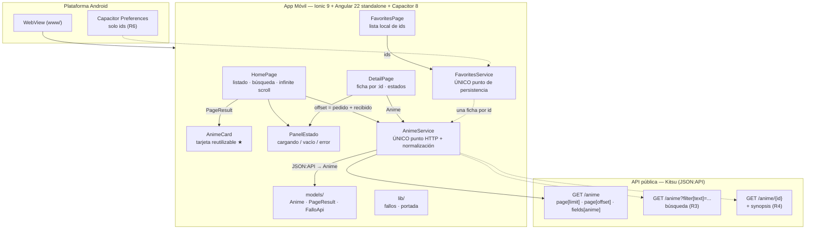
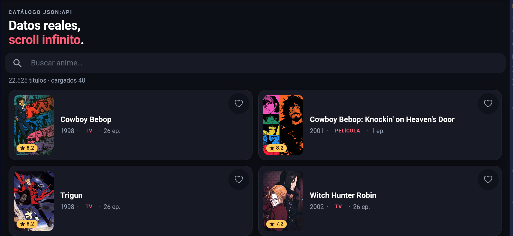
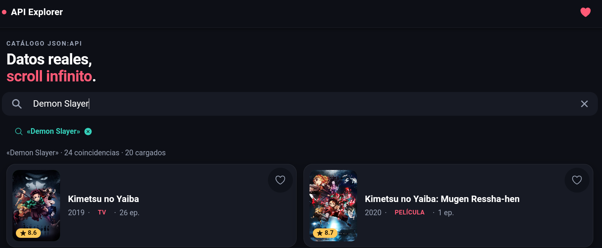
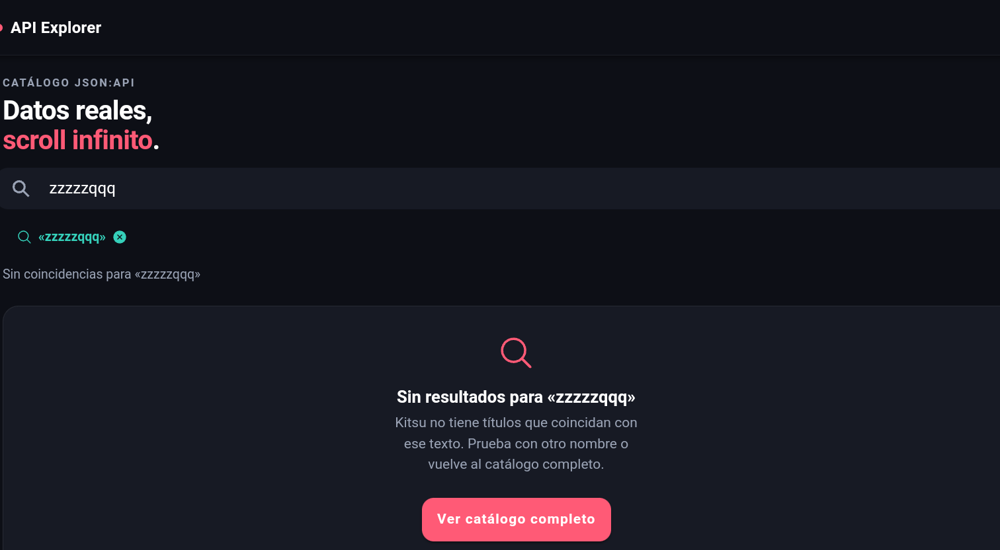
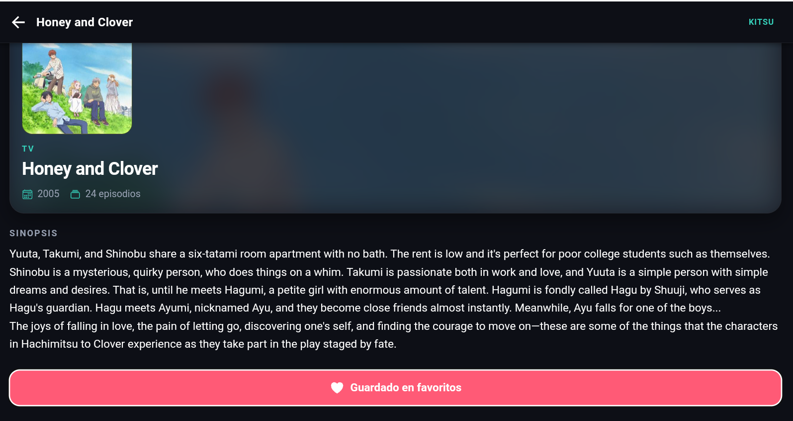
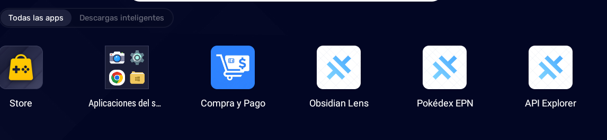

<div align="center">
  
  <h1>🎌 API Explorer</h1>
  <p><em>App móvil de exploración de un catálogo real de anime: listado con infinite scrolling, búsqueda, detalle, favoritos locales y estados de carga/error. Reto práctico de Integración de APIs — ESFOT.</em></p>

  <p>
    
    
    
    
    
    
    
    
  </p>
</div>

---

## 📖 Descripción del Proyecto

**API Explorer** consume la API pública **[Kitsu](https://kitsu.io/api/edge/anime)** (22 515 títulos, sin clave y con CORS habilitado) para mostrar un catálogo real de anime en una app móvil construida con **Ionic + Angular standalone + Capacitor**. Los 7 requisitos de la actividad están implementados:

1. **Listado remoto real (R1):** carga la primera página desde `https://kitsu.io/api/edge/anime` y normaliza el formato **JSON:API** a un modelo propio `Anime` (título, portada, año, tipo, episodios y nota ★).
2. **Scroll infinito robusto (R2):** `ion-infinite-scroll` con paginación real por `page[offset]`, **sin duplicados** (conjunto de ids), `complete()` garantizado en `finally` (también ante error) y **fin de datos real** calculado con `meta.count` — nunca simulado repitiendo peticiones.
3. **Búsqueda con reinicio total (R3):** `ion-searchbar` con `debounce="400"`; al escribir se limpian resultados, ids y paginación, se descartan las respuestas tardías y "sin resultados" se distingue de "error de conexión".
4. **Detalle con `:id` (R4):** ruta *lazy* `anime/:id`, ficha con portada, ficha técnica y sinopsis, con `ion-back-button` para regresar **conservando el scroll** del listado.
5. **Estados de interfaz (R5):** skeleton con shimmer, lista vacía ≠ error de conexión, error con botón **Reintentar** que retoma el mismo offset / el mismo id sin perder lo ya cargado — en el listado **y** en el detalle.
6. **Favoritos locales (R6):** estrella de 44 px en tarjeta y ficha, guardados como **ids** en `@capacitor/preferences`; sobreviven a cerrar y volver a abrir la app.
7. **Estructura profesional (R7):** todo el HTTP vive en un único `AnimeService`, la persistencia en un único `FavoritesService`, las interfaces están en `models/`, la UI se compone con componentes reutilizables y las rutas son *lazy* con `loadComponent`.

---

## ✨ Características Principales

- 🎬 **Catálogo real, no simulado:** datos en vivo de Kitsu (22 515 registros) servidos en lotes de 20; cada tarjeta muestra portada con *fallback* a un monograma teñido por id, ★ nota /10, año · tipo · episodios.
- ♾️ **Infinite scrolling blindado:** guard contra peticiones simultáneas, deduplicación por `id` (también **dentro** de una misma página), `[disabled]` al agotar el catálogo y `complete()` SIEMPRE en el bloque `finally`.
- 🧭 **Paginación honesta:** `hasMore = items.length > 0 && offset + 20 < meta.count`; cuando la API responde con `data: []` la paginación se corta en seco (nada de bucles infinitos).
- 💔 **Errores que no rompen la UI:** si falla la página N, la lista anterior se conserva, aparece un aviso inline y el reintento repite exactamente el mismo offset. El copy distingue **red caída / 429 límite / 5xx servidor / 4xx cliente**.
- 🔎 **Búsqueda con reinicio total (R3):** `ion-searchbar` con `debounce="400"`; un **token de generación** descarta respuestas y fallos de una búsqueda anterior para que no pisen la nueva.
- 🧭 **Detalle navegable (R4):** se entra tocando la tarjeta, se sale con `ion-back-button`, y `ion-router-outlet` cachea la vista de home → **no se pierde la posición de scroll**.
- 🗂 **Estados compartidos:** un único `PanelEstadoComponent` da la misma cara a carga, vacío y error en home, detalle y favoritos.
- ⭐ **Favoritos offline (R6):** solo ids en Preferences (el catálogo sigue viniendo de la API); `init()` idempotente vía `provideAppInitializer` para que la estrella salga marcada en el primer render.
- 🎨 **Identidad propia (no genérica):** tema *medianoche + coral sakura* con los 5 tonos personalizados en `variables.scss`, tipografía y jerarquía diseñadas para móvil.
- ⚡ **Rendimiento:** `OnPush`, `loading="lazy"` en portadas, iconos registrados con `addIcons()` (cero descargas en runtime), *lazy chunks* por página y Angular 22 con signals.

---

## 🏗️ Arquitectura del Sistema



**Reglas de la arquitectura (las que sostienen el código):**
- Un solo archivo con `HttpClient` (`AnimeService`) y otro con `Preferences` (`FavoritesService`).
- JSON:API se normaliza **una sola vez** (`toAnime`): ninguna página ve `data[].attributes`.
- Los componentes de UI (`anime-card`, `panel-estado`) son **presentacionales**: reciben inputs y emiten outputs, no inyectan servicios.
- Las rutas son *lazy* y el `id` llega por `input()` (`withComponentInputBinding()`), no por `ActivatedRoute`.

---

## 🛠️ Tecnologías Usadas

### App móvil
- **Framework:** Ionic 9 (componentes standalone) + Angular 22.2 (signals, `OnPush`, rutas *lazy*, control flow `@if/@for`)
- **Nativo:** Capacitor 8.5 — `@capacitor/preferences` (persistencia de favoritos)
- **HTTP:** `HttpClient` + `withFetch()`, inyectado una sola vez en `main.ts`
- **Estado:** signals de Angular (`items`, `cargando`, `fallo`, `hasMore`, `idsFavoritos`)
- **Iconos:** `ionicons` registrados con `addIcons()` (sin *fetch* en runtime)

### Calidad
- **Compilación:** `ng build` → **0 errores, 0 warnings** · *bundle* inicial 674,53 kB (≈159,40 kB comprimido); *chunks* perezosos: `home-page` 11,84 kB · `detail-page` 11,22 kB · `favorites-page` 6,99 kB
- **Tests:** Vitest 5 + Angular — **59/59 en 7 archivos** (paginación, dedupe, guard, `finally`, vacío ≠ error, reinicio de búsqueda, detalle/404, favoritos)
- **Tipos:** `tsc --noEmit` sobre `tsconfig.app.json` y `tsconfig.spec.json` → 0 errores
- **Lint:** ESLint 10 + `angular-eslint` → *pass*
- **Seguridad:** `npm audit` → **0 vulnerabilidades** (ver `AUDITORIA-DEPS.md`)
- **Plataforma Android:** Gradle 8.14.3 + JDK 21, compilado **por terminal** (sin Android Studio)

### API
- **Fuente:** Kitsu API Edge — `https://kitsu.io/api/edge/anime`
- **Formato:** JSON:API (`links`, `meta.count`, `data[].attributes`)
- **Ventaja elegida:** sin clave secreta, CORS abierto y paginación real por offset — verificada con HTTP 200 antes de escribir una sola línea de código.

---

## 🌐 API y Paginación (la decisión clave)

```text
Listado    GET https://kitsu.io/api/edge/anime
             ?page[limit]=20&page[offset]=0
             &fields[anime]=canonicalTitle,posterImage,startDate,averageRating,episodeCount,subtype
             Cabecera: Accept: application/vnd.api+json

Búsqueda   GET .../anime?filter[text]=<query>&page[limit]=20&page[offset]=0
             (solo se añade filter[text] si la consulta no está vacía)

Detalle    GET .../anime/{id}?fields[anime]=…,synopsis
             404 / 200 sin recurso  →  estado "no encontrado" (≠ error de red)
```

| Decisión | Implementación |
|---|---|
| Lote de 20 | `pageSize = 20` (Kitsu admite hasta 20) |
| **Avance del offset** | `offset = offset_pedido + items_recibidos` — **no** `+= 20`: una página corta no salta títulos |
| **Fin real** | `hasMore = items.length > 0 && offset + pageSize < meta.count` |
| Sin duplicados | `Set<string>` de ids; solo entra lo nuevo a `items` (también se deduplica dentro de una página) |
| Sin simultáneas | guard `cargando` activado **síncrono** antes del primer `await` |
| Recuperación | `complete()` en `finally` + reintento del **mismo** offset |
| Búsqueda | reinicio total de lista/ids/offset + **token de generación** que descarta respuestas viejas |
| Límite de la API | `debounce` de 400 ms (Kitsu: 3 req/s); el 429 se muestra como *"límite alcanzado"* |

---

## 🚀 Instalación y Ejecución Local

### 1. Clonar el repositorio
```bash
git clone https://github.com/JimSul16/API-Explorer.git
cd API-Explorer
```

### 2. Instalar dependencias
```bash
npm install
```
> Requisitos verificados: **Node 22** (npm 10), Ionic CLI 7.2 (`npm i -g @ionic/cli`) y, para el APK, **JDK 21** + Android SDK (`ANDROID_HOME` puede estar vacío: se resuelve con `android/local.properties`).

### 3. Ejecutar en el navegador
```bash
npm start              # ng serve → http://localhost:4200
# o, con el CLI de Ionic (puerto 8100):
npx ionic serve
```

### 4. Ejecutar la suite de pruebas
```bash
npm test -- --watch=false             # 59/59 tests en 7 archivos (Vitest)
npx tsc -p tsconfig.app.json --noEmit   # tipos app: 0 errores
npx tsc -p tsconfig.spec.json --noEmit  # tipos tests: 0 errores
npm run lint                            # ESLint
```

---

## 📦 Compilación del APK (por terminal)

```bash
npm run build                  # 1. compilar la web → www/
npx cap sync android           # 2. sincronizar con el proyecto Android
cd android
.\gradlew.bat assembleDebug    # 3. compilar el APK (en Linux/macOS: ./gradlew assembleDebug)
```

**Salida:** `android\app\build\outputs\apk\debug\app-debug.apk`
✅ **generado y verificado: 4,44 MB (4 653 669 bytes)** — BUILD SUCCESSFUL en 22 s, **25/10/2026**, sobre el estado final R1–R7.

Se instala en el celular o emulador con `adb install -r android\app\build\outputs\apk\debug\app-debug.apk`.

---

## 📁 Estructura del Proyecto (R7)

```text
src/app/
├── app.routes.ts                  rutas lazy: home · anime/:id · favoritos · ** → home
├── app.component.ts               raíz standalone (ion-app + ion-router-outlet)
├── models/
│   └── anime.model.ts             Anime · PageResult · FalloApi/FalloApiTipo
├── services/
│   ├── anime.service.ts           ÚNICA puerta a Kitsu (HttpClient) + normalización + paginación
│   ├── anime.service.spec.ts      contrato de params, normalización, hasMore, clasificación de fallos
│   ├── favorites.service.ts       ÚNICA puerta a Preferences (solo ids, signal)
│   └── favorites.service.spec.ts
├── lib/
│   ├── fallos.ts / fallos.spec.ts mensajes y etiquetas de error (404 ≠ red ≠ 429)
│   └── portada.ts                 iniciales, matiz del monograma y nota /10
├── components/
│   ├── anime-card/                tarjeta reutilizable ★ (portada 2:3 + monograma + botón favorito)
│   └── panel-estado/              panel compartido: cargando · vacío · error + acción
└── pages/
    ├── home/                      listado + búsqueda + infinite scroll + estados (R1, R2, R3, R5)
    ├── detail/                    ficha por :id con sus estados (R4, R5)
    └── favorites/                 favoritos locales con estados (R6, R5)

src/theme/variables.scss           paleta e identidad (medianoche + coral)
src/global.scss                    tema oscuro + estilos compartidos
src/main.ts                        provideHttpClient(withFetch) + addIcons + provideAppInitializer
src/environments/environment.ts    apiUrl de Kitsu (único punto de cambio de API)

screenshots/                       evidencias gráficas de la entrega (5 capturas PNG)
```

---

## ✅ Requisitos de la Actividad

| # | Requisito | Estado |
|---|---|---|
| **R1** | Listado remoto con ≥2 atributos por tarjeta | ✅ |
| **R2** | Infinite scrolling sin duplicados y con fin real | ✅ |
| **R3** | Búsqueda con reinicio de resultados y paginación | ✅ |
| **R4** | Pantalla de detalle con `:id` y regreso | ✅ |
| **R5** | Estados: carga, vacío, error y reintento | ✅ (listado, detalle y favoritos) |
| **R6** | Favoritos con Capacitor Preferences | ✅ |
| **R7** | Servicio HTTP + interfaces + componentes separados | ✅ |

> **Verificación automática (25/10/2026):** `verificador-build` → **BUILD: verde**, 0 errores / 0 warnings,
> 59/59 tests · `revisor-rubrica` → **92/100**, con el único punto flojo en las **capturas/video**… ya subsanado:
> la evidencia gráfica de los 7 requisitos está incrustada en la sección *Evidencias* de este README.

---

## 🧩 Dificultades y Decisiones

- **Jikan (MyAnimeList) inaccesible** desde la red local (timeout en 4 intentos) → se verificó y eligió **Kitsu**; Open Library y AniList quedaron como respaldo documentado.
- **El JSON:API no sirve como modelo:** `data[].attributes` se normaliza en `AnimeService` para que las páginas jamás toquen la forma cruda de la respuesta.
- **Reiniciar la búsqueda con una carga de scroll en vuelo dejaba mudo al `ion-infinite-scroll`** (Ionic pone `isLoading=false` en `disabledChanged()` sin resetear `didFire`) → `reiniciar()` **espera la petición en curso** antes de vaciar, y un **token de generación** descarta respuestas y fallos de una búsqueda vieja.
- **`[disabled]` del scroll incluye `error()` a propósito:** se probó a quitarlo y apareció un **bucle de reintentos** (`complete()` oculta el spinner → el contenido encoge → salta `scroll` → nueva petición → falla → …). La solución final es pausar el scroll tras el fallo y reintentar de forma **explícita** con el botón.
- **Duplicados dentro de una misma página:** deduplicar solo entre páginas hacía que `track anime.id` saltara NG0955 → el `Set` se aplica también a lo recién llegado.
- **El offset no puede avanzar `+= 20`:** con una página corta no final se saltaban títulos → avanza por lo **recibido** (`offset + items.length`).
- **404 ≠ caída de red:** `getAnimeById` traduce un 200 sin recurso a `HttpErrorResponse` y `esNoEncontrado()` es la única regla de "no existe"; `FalloApi` tipa `red | limite | servidor | cliente | desconocido` para que la UI elija el mensaje.
- **Favoritos = ids, no objetos:** guardar objetos duplicaría datos que ya viven en la API; `init()` es idempotente y `toggle()` revierte **solo ese id** si la escritura falla.
- **Presupuesto de estilos:** `home.page.scss` superaba 2 kB → budget recalibrado en `angular.json` a 3 kB (warning) / 6 kB (error) sin mutilar la UI, extrayendo los paneles de estado a un componente propio.
- **La status bar de Android salía azul** (`#303F9F`, color por defecto de `@capacitor/android`) sobre una interfaz medianoche → se añadió `values/colors.xml` con la paleta de la app y `android:statusBarColor` en el tema nativo.
- **5 vulnerabilidades en dependencias** (1 high) → resueltas **sin** `npm audit fix --force` (que habría *degradado* Angular): `overrides` de `vite` a `^8.3.5` y `uuid` a `^11.1.1` → **`npm audit`: 0**. Detalle en `AUDITORIA-DEPS.md`.
- **`ANDROID_HOME` vacío en la máquina:** el SDK se resuelve con `android/local.properties` (`sdk.dir=C\:\\Users\\...`).

---

## 📝 Evidencias

| Verificación | Resultado |
|---|---|
| `npm run build` | ✅ 0 errores, 0 warnings |
| `npx tsc -p tsconfig.app.json --noEmit` | ✅ 0 |
| `npx tsc -p tsconfig.spec.json --noEmit` | ✅ 0 |
| `npm run lint` | ✅ *All files pass linting* |
| `npm test -- --watch=false` | ✅ **59/59** en 7 archivos |
| `npm audit` | ✅ **0 vulnerabilidades** |
| `.\gradlew.bat assembleDebug` | ✅ **BUILD SUCCESSFUL** → `app-debug.apk` **4,44 MB** (25/10/2026) |

- **Historial de commits atómicos por fase:**

```text
1269883 fase-B: scaffold Ionic standalone + estructura R7 + configs
b7116f2 fase-C-D: R1 listado real de Kitsu + R2 scroll infinito robusto
0f7bfe8 fase-F: verificación final del alcance R1+R2+R7 + docs de cierre
8b40df9 evidencia-apk: APK debug por terminal (4,16 MB)
9c5d1f9 docs: README profesional estilo portfolio
059c4c0 pulido-R1R2R7 (DeepSeek): modelo/servicio/home + tests
7232eb2 pulido-R1R2R7: correcciones de revisor + tests
a1a423f fase-E-R3: búsqueda con reinicio total y token de generación
417b3d1 fase-G-R4R5: detalle anime/:id con estados y reintento
f0998a4 fase-G-R6: favoritos con Capacitor Preferences y estrella
fc77b64 fase-G-R6: estilos compartidos en global.scss
29b2195 fase-H-parcial: auditoría de dependencias + status bar Android
6f8bdef fase-H: verificación final, APK 4,44 MB, npm audit 5→0 y README final
8552884 chore: limpieza del repo para la entrega (docs internos y config de la IA fuera)
fe97acd docs: capturas de la entrega en screenshots/
```

- **Repositorio:** ✅ **https://github.com/JimSul16/API-Explorer** (branch `main`)

### 📸 Capturas de la entrega

> App en ejecución con **datos en vivo de Kitsu** · 27/10/2026 · tema oscuro, sin editar ninguna imagen.

**1 · Listado real + infinite scrolling (R1 + R2)** — tras hacer scroll la cabecera marca
`22.525 títulos · cargados 40` (dos páginas de 20 concatenadas, sin duplicados):



**2 · Búsqueda con reinicio total (R3)** — chip «Demon Slayer» con su ✕, cifras recalculadas
(`24 coincidencias · 20 cargados`) y resultados filtrados:



**3 · "Sin resultados" ≠ "error de conexión" (R3 + R5)** — 200 con `data: []`: panel propio con la
acción *Ver catálogo completo*, no un fallo de red:



**4 · Detalle con `:id` + favorito guardado (R4 + R6)** — ficha de *Honey and Clover* (hero, tipo,
año, episodios, sinopsis) y el botón en estado **Guardado en favoritos**:



**5 · APK instalado en el dispositivo** — icono **API Explorer** en el cajón de apps del teléfono
(el APK de 4,44 MB compilado por terminal):



> 🕐 **Opcionales todavía no grabados** (no son obligatorios: la actividad pide *captura **o** video corto*):
> panel de error con *Reintentar* (modo avión), skeleton de carga, página de favoritos y un video de ≤60 s.

---

<div align="center">
  <p><em>🧩 Reto práctico de <strong>Desarrollo de Aplicaciones Móviles</strong> — Escuela Politécnica Nacional (EPN · ESFOT)</em></p>
  <p><em>⚙️ Desarrollado con 🟦 MiMo (infraestructura, build, APK y auditoría) + 🟩 DeepSeek (código e interfaz)</em></p>
  <p><sub>API Explorer · Kitsu API · Ionic + Angular standalone + Capacitor · Octubre 2026</sub></p>
</div>
