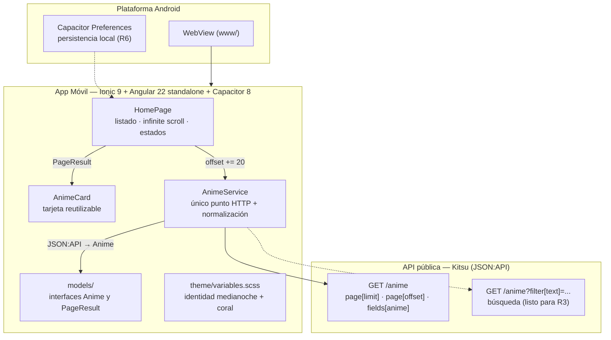

<div align="center">
  
  <h1>🎌 API Explorer</h1>
  <p><em>App móvil de exploración de un catálogo real de anime: listado con infinite scrolling, estados de carga/error y estructura profesional de código. Reto práctico de Integración de APIs — ESFOT.</em></p>

  <p>
    
    
    
    
    
    
    
  </p>
</div>

---

## 📖 Descripción del Proyecto

**API Explorer** consume la API pública **[Kitsu](https://kitsu.io/api/edge/anime)** (22 515 títulos, sin clave y con CORS habilitado) para mostrar un catálogo real de anime en una app móvil construida con **Ionic + Angular standalone + Capacitor**. La aplicación:

1. **Listado remoto real (R1):** carga la primera página desde `https://kitsu.io/api/edge/anime` y normaliza el formato **JSON:API** a un modelo propio `Anime` (título, portada, año, tipo, episodios y nota ★).
2. **Scroll infinito robusto (R2):** `ion-infinite-scroll` con paginación real por `page[offset]`, **sin duplicados** (conjunto de ids), `complete()` garantizado en `finally` (también ante error) y **fin de datos real** calculado con `meta.count` — nunca simulado repitiendo peticiones.
3. **Estados de interfaz (R5):** skeleton con shimmer, lista vacía ≠ error de conexión, error inline con botón **Reintentar** que retoma el mismo offset sin perder la lista ya cargada.
4. **Estructura de código profesional (R7):** todo el HTTP vive en un único `AnimeService`, las interfaces están separadas en `models/`, la UI se compone con el componente reutilizable `anime-card` y las rutas son *lazy* con `loadComponent`.

---

## ✨ Características Principales

- 🎬 **Catálogo real, no simulado:** datos en vivo de Kitsu (22 515 registros) servidos en lotes de 20; cada tarjeta muestra portada con *fallback* a un monograma, ★ nota /10, año · tipo · episodios.
- ♾️ **Infinite scrolling blindado:** guard contra peticiones simultáneas, deduplicación por `id`, `[disabled]` al agotar el catálogo y `complete()` SIEMPRE en el bloque `finally`.
- 🧭 **Paginación honesta:** `hasMore = offset + 20 < meta.count`; cuando la API responde con `data: []` la paginación se corta en seco (nada de bucles infinitos).
- 💔 **Errores que no rompen la UI:** si falla la página N, la lista anterior se conserva, aparece un aviso inline y el reintento repite exactamente el mismo offset.
- 🔎 **Búsqueda con reinicio total (R3):** `ion-searchbar` con `debounce="400"`; al escribir se limpian resultados, ids y paginación, se descartan las respuestas tardías y "sin resultados" se distingue de "error de conexión".
- 🗂 **Estados compartidos:** un único `PanelEstadoComponent` da la misma cara a carga, vacío y error en todas las pantallas (home y detalle).
- 🎨 **Identidad propia (no genérica):** tema *medianoche + coral sakura* con los 5 tonos personalizados en `variables.scss`, tipografía y jerarquía diseñadas para móvil.
- ⚡ **Rendimiento:** `OnPush`, `loading="lazy"` en portadas, iconos registrados en `main.ts` (cero descargas en runtime) y Angular 22 con signals.

---

## 🏗️ Arquitectura del Sistema



---

## 🛠️ Tecnologías Usadas

### App móvil
- **Framework:** Ionic 9 (componentes standalone) + Angular 22 (signals, `OnPush`, rutas *lazy*)
- **Nativo:** Capacitor 8 (`@capacitor/preferences` instalado para favoritos)
- **HTTP:** `HttpClient` + `withFetch()` — inyectado una sola vez en `main.ts`
- **Estado:** signals de Angular (`items`, `cargando`, `error`, `hasMore`)
- **Iconos:** `ionicons` registrados con `addIcons()` (sin fetch en runtime)

### Calidad
- **Compilación:** `ng build` (presupuestos de bundle y de estilos por componente)
- **Tests:** Vitest 5 con Angular — paginación, dedupe, guard, `finally`, vacío ≠ error y **reinicio de búsqueda** (home + servicio + shell). *Cifra definitiva al cierre de la fase G.*
- **Lint:** ESLint 10 + `angular-eslint`
- **Plataforma Android:** Gradle (compilado **por terminal**, sin Android Studio)

### API
- **Fuente:** Kitsu API Edge — `https://kitsu.io/api/edge/anime`
- **Formato:** JSON:API (`links`, `meta.count`, `data[].attributes`)
- **Ventaja elegida:** sin clave secreta, CORS abierto y paginación real por offset — verificada con HTTP 200 antes de escribir una sola línea de código.

---

## 🌐 API y Paginación (la decisión clave)

```text
Listado    GET https://kitsu.io/api/edge/anime
             ?page[limit]=20&page[offset]=0
             &fields[anime]=canonicalTitle,posterImage,startDate,averageRating,episodeCount,subtype
Búsqueda   GET .../anime?filter[text]=<query>&page[limit]=20&page[offset]=0
Detalle    GET .../anime/{id}
```

| Decisión | Implementación |
|---|---|
| Lote de 20 | `PAGE_SIZE = 20`; la página avanza `offset += 20` |
| **Fin real** | `hasMore = items.length > 0 && offset + pageSize < meta.count` |
| Sin duplicados | `Set<string>` de ids; solo entra lo nuevo a `items` |
| Sin simultáneas | guard `cargando` activado **síncrono** antes del primer `await` |
| Recuperación | `complete()` en `finally` + reintento del **mismo** offset |

---

## 🚀 Instalación y Ejecución Local

### 1. Clonar el repositorio
```bash
git clone https://github.com/tu-usuario/API-Explorer.git
cd API-Explorer
```

### 2. Instalar dependencias
```bash
npm install
```
> Requisitos: **Node 22**, Ionic CLI 7.2 (`npm i -g @ionic/cli`) y, para el APK, **JDK 17+** + Android SDK.

### 3. Ejecutar en el navegador
```bash
npm start              # ng serve → http://localhost:4200
# o, con el CLI de Ionic (puerto 8100):
npx ionic serve
```

### 4. Ejecutar la suite de pruebas
```bash
npm test -- --watch=false     # suite completa (Vitest) — cifra final al cierre de la fase G
npm run lint                  # ESLint
npx tsc -p tsconfig.app.json --noEmit   # tipos: 0 errores
```

---

## 📦 Compilación del APK (por terminal)

```bash
npm run build                  # 1. compilar la web → www/
npx cap sync android           # 2. sincronizar con el proyecto Android
cd android
./gradlew assembleDebug        # 3. compilar el APK (Windows: .\gradlew.bat)
```

**Salida:** `android\app\build\outputs\apk\debug\app-debug.apk` — ✅ **generado y verificado: 4.16 MB** (BUILD SUCCESSFUL en 37 s). Se instala directamente en el celular o emulador con `adb install`.

---

## 📁 Estructura del Proyecto (R7)

```text
src/app/
├── models/anime.model.ts        interfaces Anime y PageResult
├── services/anime.service.ts    TODO el HTTP (Kitsu) + normalización + paginación
├── components/anime-card/       tarjeta reutilizable (portada 2:3 + monograma)
├── pages/home/                  listado + infinite scroll + estados (R1, R2, R5)
├── app.routes.ts                rutas lazy con loadComponent
└── app.component.ts             raíz standalone
```

---

## ✅ Requisitos de la Actividad

| # | Requisito | Estado |
|---|---|---|
| **R1** | Listado remoto con ≥2 atributos por tarjeta | ✅ |
| **R2** | Infinite scrolling sin duplicados y con fin real | ✅ |
| **R3** | Búsqueda con reinicio de resultados y paginación | ✅ |
| **R4** | Pantalla de detalle con `:id` y regreso | ⏳ en curso (fase G) |
| **R5** | Estados: carga, vacío, error y reintento | ✅ (home + panel compartido; detalle ⏳ en fase G) |
| **R6** | Favoritos con Capacitor Preferences | ⏳ en curso (fase G) |
| **R7** | Servicio HTTP + interfaces + componentes separados | ✅ |

> **Revisión de rúbrica:** valores **definitivos al cierre de la fase G** — hoy ya van
> R1 20/20 · R2 25/25 · R3 15/15 · R7 20/20 · estados 10/10 (75 de 85 posibles hasta aquí).

---

## 🧩 Dificultades y Decisiones

- **Jikan (MyAnimeList) inaccesible** desde la red local (timeout en 4 intentos) → se verificó y eligió **Kitsu**; Open Library y AniList quedaron como respaldo documentado.
- **El JSON:API no sirve como modelo:** `data[].attributes` se normaliza en `AnimeService` para que las páginas jamás toquen la forma cruda de la respuesta.
- **Angular 22 vs. el scaffold:** `.browserslistrc` venía con versiones fuera del soporte oficial → ajustado a `last 2 versions` (build sin warnings).
- **Presupuesto de estilos:** `home.page.scss` superaba 2 kB → budget recalibrado en `angular.json` a 3 kB (warning) / 6 kB (error) sin mutilar la UI.

---

## 📝 Evidencias

- **Build:** `npm run build` → 0 errores y 0 warnings · `tsc` → 0 · `lint` → pass · **tests:** ✅ *cifra definitiva al cierre de la fase G*
- **APK:** `app-debug.apk` compilado **por terminal** (sin Android Studio) — se regenera al cerrar R3–R6
- **Historial:** commits atómicos por fase (`fase-B` → `fase-C-D` → `fase-F` → `evidencia-apk` → `pulido` → `fase-E-R3`)
- **Repositorio:** ✅ **https://github.com/JimSul16/API-Explorer** (branch `main`, historial por fases)

### 📸 Capturas y video (huecos por rellenar en la entrega)

| # | Qué se captura | Estado |
|---|---|---|
| 1 | Listado con infinite scrolling (varias pantallas de tarjetas) | ⬜ pendiente |
| 2 | Búsqueda activa + estado "sin resultados" | ⬜ pendiente |
| 3 | Skeleton de carga y panel de error con *Reintentar* | ⬜ pendiente |
| 4 | Pantalla de detalle (`:id`) y regreso al listado | ⬜ pendiente (fase G) |
| 5 | Favoritos marcados y persistidos tras reiniciar la app | ⬜ pendiente (fase G) |
| 6 | Video corto (≤60 s) del scroll infinito + búsqueda | ⬜ pendiente |
| 7 | APK instalado en el celular / emulador | ⬜ pendiente |

> **Formato sugerido:** `docs/capturas/01-listado.png` … `07-apk.png` y `docs/video-scroll.mp4`,
> referenciados aquí con ``. ⬜ = hueco pendiente de subir.

---

<div align="center">
  <p><em>🧩 Reto práctico de <strong>Desarrollo de Aplicaciones Móviles</strong> — Escuela Politécnica Nacional (EPN · ESFOT)</em></p>
  <p><em>⚙️ Desarrollado con 🟦 MiMo (infraestructura, build y APK) + 🟩 DeepSeek (código e interfaz)</em></p>
  <p><sub>API Explorer · Kitsu API · Ionic + Angular standalone + Capacitor · Octubre 2026</sub></p>
</div>
